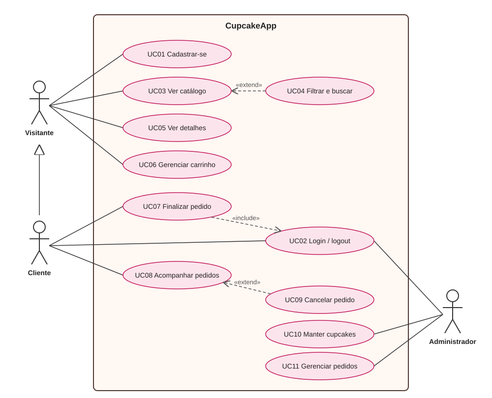
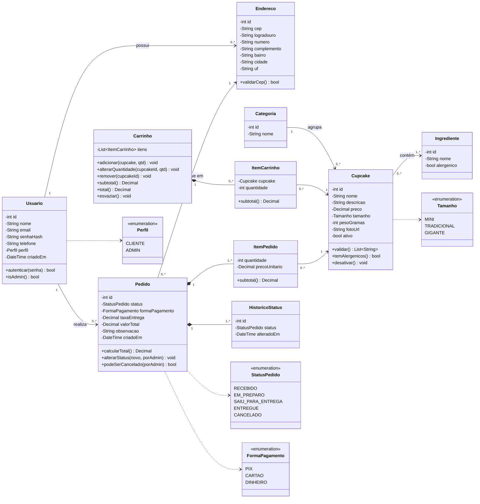
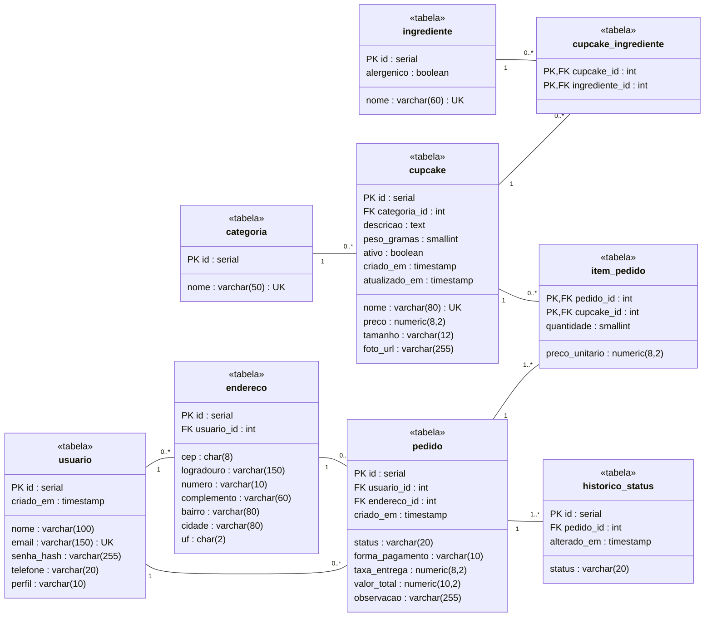
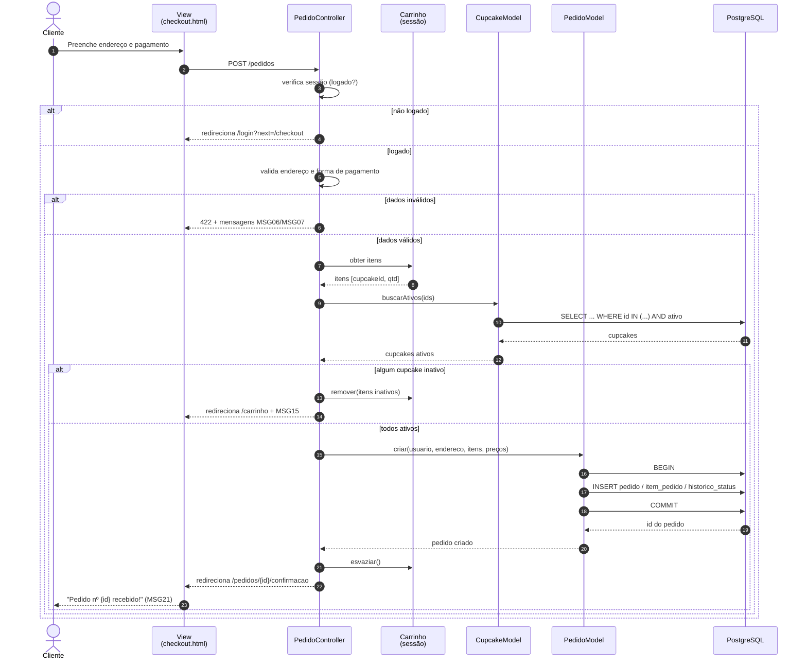
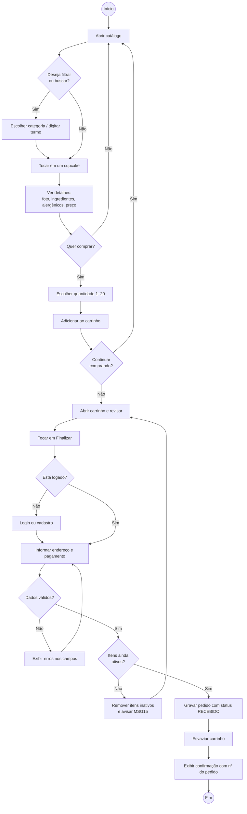
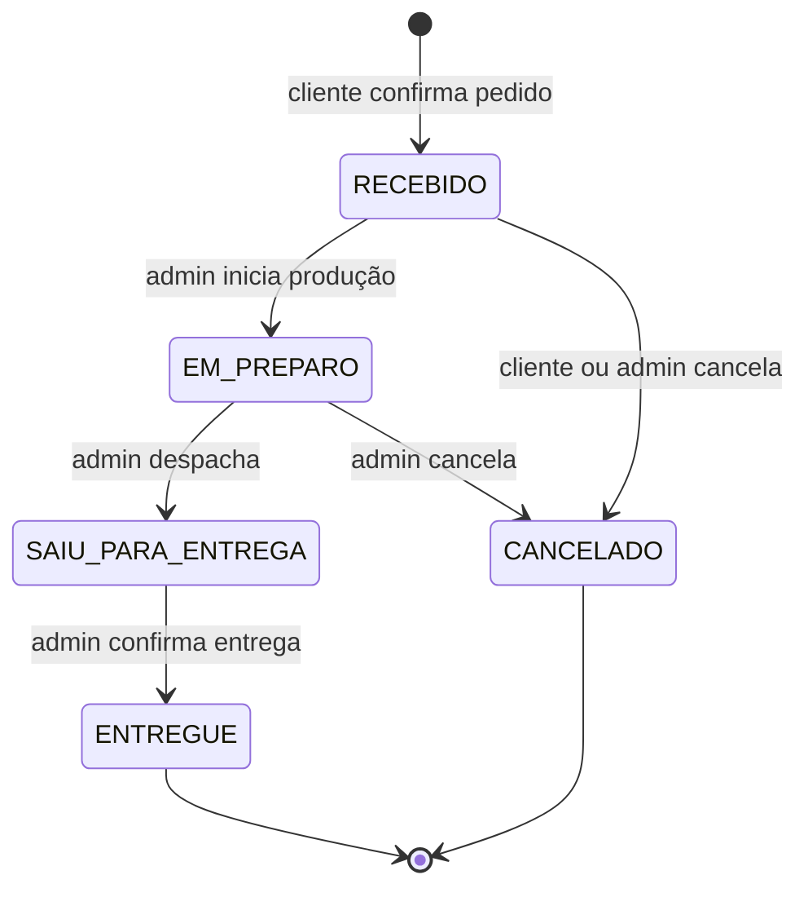

# 2. Modelagem UML – CupcakeApp

Os diagramas estão escritos em **Mermaid**, e o GitHub os desenha automaticamente ao abrir este arquivo. As versões em imagem (PNG) e o código-fonte de cada diagrama (`.mmd`) estão na pasta [`diagramas/`](diagramas/), prontos para colar num documento ou slide.

---

## 2.1 Diagrama de Casos de Uso

*Imagem também em [PNG](diagramas/casos-de-uso.png). O diagrama de casos de uso foi desenhado em SVG porque o Mermaid não tem notação UML própria para atores e casos de uso.*

**Leitura do diagrama:** a seta com triângulo vazado indica **generalização**: o *Cliente* é um *Visitante* autenticado e herda todos os casos de uso dele. «include» indica que finalizar o pedido **sempre** exige login. «extend» indica comportamentos **opcionais**: filtrar o catálogo e cancelar um pedido a partir do acompanhamento. O *Administrador* também faz login (UC02).

### Especificação do caso de uso principal – UC07 Finalizar pedido

| Item | Descrição |
|---|---|
| **Ator** | Cliente |
| **Pré-condições** | O carrinho tem pelo menos 1 item. |
| **Pós-condições** | Pedido gravado com status RECEBIDO e carrinho esvaziado. |
| **Fluxo principal** | 1. O cliente toca em "Finalizar pedido" no carrinho. 2. O sistema verifica se o cliente está logado (include UC02). 3. O sistema exibe o resumo do pedido e o formulário de endereço, já preenchido com o último endereço usado, se houver. 4. O cliente confirma ou edita o endereço e escolhe a forma de pagamento (PIX, cartão ou dinheiro na entrega). 5. O cliente toca em "Confirmar pedido". 6. O sistema valida os dados e confere se todos os cupcakes continuam ativos. 7. O sistema grava o pedido com os preços atuais congelados (RN05) e calcula o total (RN06). 8. O sistema esvazia o carrinho e mostra a tela de confirmação com o número do pedido. |
| **Fluxo alternativo A1** – não logado | No passo 2, o sistema redireciona para o login e, depois de autenticar, volta ao passo 3 com o carrinho preservado. |
| **Fluxo de exceção E1** – dados inválidos | No passo 6, o sistema destaca os campos com erro (MSG06/MSG07) e volta ao passo 4. |
| **Fluxo de exceção E2** – cupcake desativado | No passo 6, o sistema remove o item, exibe MSG15 e volta ao carrinho. |
| **Regras** | RN03, RN04, RN05, RN06, RN10 |

---

## 2.2 Diagrama de Classes (domínio)

Este diagrama mostra as classes do sistema com atributos e principais métodos. A classe **Carrinho** existe apenas na sessão do usuário e **não é persistida** no banco.

🖼 Versão em imagem: [classes.png](diagramas/classes.png)

**Notas de modelagem**
- **Composição** (losango cheio): um `ItemPedido` não existe sem o seu `Pedido`. O mesmo vale para `ItemCarrinho` em relação ao `Carrinho` e para `HistoricoStatus` em relação ao `Pedido`.
- `ItemPedido.precoUnitario` guarda uma cópia do preço no momento da compra (RN05). Por isso ele não é redundante com `Cupcake.preco`.
- O relacionamento Cupcake ↔ Ingrediente é **muitos-para-muitos**: um cupcake tem vários ingredientes e um ingrediente (ex.: leite) aparece em vários cupcakes.

### 2.2.1 Diagrama de Classes de Persistência

Estas são as classes que viram tabelas, com as chaves e os tipos que serão usados no banco. Daqui saem os modelos lógico e físico do documento 04.

🖼 Versão em imagem: [classes-persistencia.png](diagramas/classes-persistencia.png)

---

## 2.3 Diagrama de Sequência – Finalizar pedido (UC07)

Mostra como as camadas **MVC** conversam no fluxo mais importante do sistema.

🖼 Versão em imagem: [sequencia-finalizar-pedido.png](diagramas/sequencia-finalizar-pedido.png)

---

## 2.4 Diagrama de Atividades – Jornada de compra

🖼 Versão em imagem: [atividades-compra.png](diagramas/atividades-compra.png)

---

## 2.5 Diagrama de Estados – Pedido

Este diagrama formaliza a regra **RN07**, que define quais mudanças de status são permitidas.

🖼 Versão em imagem: [estados-pedido.png](diagramas/estados-pedido.png)

