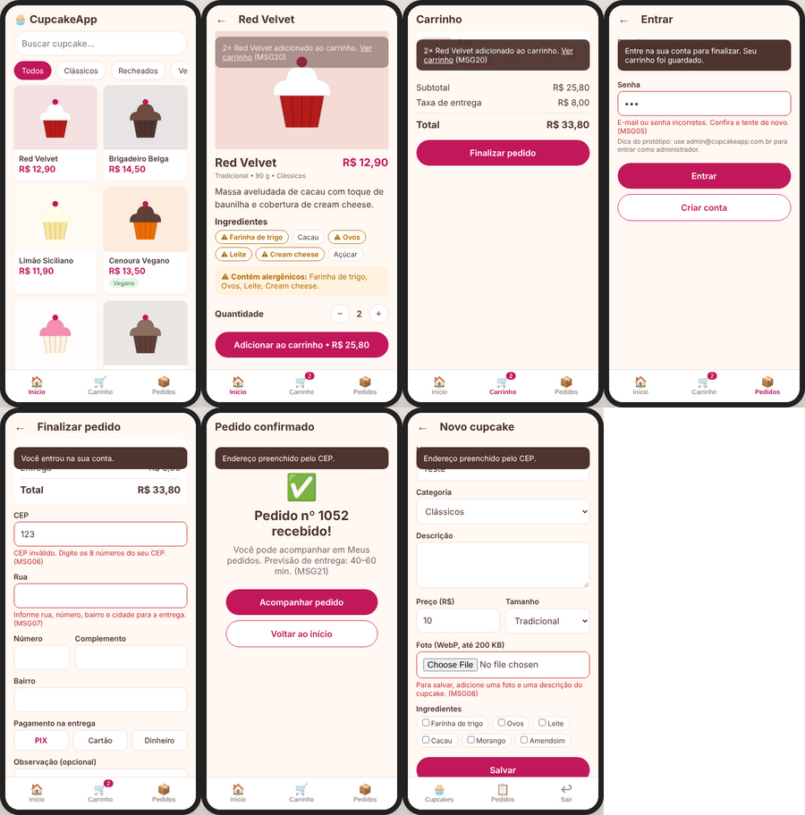
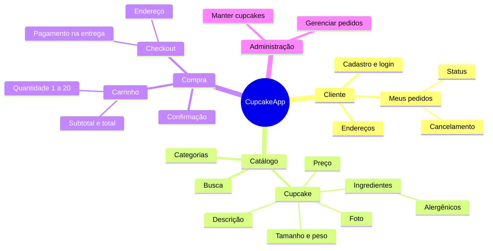
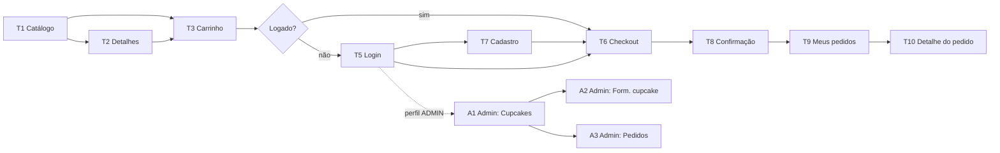

# 3. IHC – Interface Humano-Computador

O **protótipo navegável** está em [`prototipo/index.html`](prototipo/index.html). Basta abrir o arquivo no navegador. Ele simula as telas do celular, com dados de exemplo, e já mostra os principais fluxos e mensagens de erro.

*Da esquerda para a direita: catálogo, detalhes com alergênicos, carrinho, login com erro (MSG05), checkout com erros de CEP e endereço (MSG06/MSG07), confirmação do pedido e formulário admin barrando cupcake sem foto (MSG08).*

---

## 3.1 Mapa conceitual do sistema

🖼 Versão em imagem: [mapa-conceitual.png](diagramas/mapa-conceitual.png)

## 3.2 Mapa de navegação

🖼 Versão em imagem: [mapa-navegacao.png](diagramas/mapa-navegacao.png)

**Navegação global:** uma barra inferior fixa, padrão em apps de celular, com 3 ícones: **Início** (catálogo), **Carrinho** (com contador de itens) e **Pedidos/Conta**. O administrador tem um menu próprio com Cupcakes e Pedidos.

## 3.3 Especificação das telas

| Tela | Objetivo | Elementos principais | Histórias |
|---|---|---|---|
| **T1 Catálogo** | Mostrar os produtos | Campo de busca; chips de categoria (Todos, Clássicos, Recheados, Veganos, Zero açúcar); grade de cards com foto, nome e preço; selo "Vegano"/"Zero açúcar". | US03, US04 |
| **T2 Detalhes** | Dar segurança na decisão de compra | Foto grande; nome; preço; tamanho e peso; descrição; lista de ingredientes com os **alergênicos destacados** e o aviso "Contém alergênicos"; seletor de quantidade (− 1 +); botão "Adicionar ao carrinho • R$ total". | US05 |
| **T3 Carrinho** | Revisar a compra | Lista de itens com miniatura, quantidade (− +) e botão de remover; subtotal; taxa de entrega; total; botão "Finalizar pedido". Estado vazio com o botão "Ver cardápio". | US06 |
| **T5 Login** | Autenticar | E-mail; senha com botão de mostrar/ocultar; botão "Entrar"; link "Criar conta". | US02 |
| **T7 Cadastro** | Criar conta | Nome; e-mail; telefone com máscara; senha com indicação do mínimo de 8 caracteres. | US01 |
| **T6 Checkout** | Coletar entrega e pagamento | Resumo do pedido; CEP com preenchimento automático do endereço; número; complemento; opções de pagamento em botões de rádio (PIX, Cartão, Dinheiro); campo de observação; botão "Confirmar pedido". | US07 |
| **T8 Confirmação** | Dar feedback de sucesso | Ícone de sucesso; "Pedido nº X recebido!"; previsão de entrega; botões "Acompanhar pedido" e "Voltar ao início". | US07 |
| **T9 Meus pedidos** | Acompanhar pedidos | Lista com nº, data, total e um selo colorido de status. | US08 |
| **T10 Detalhe do pedido** | Ver o andamento | Linha do tempo de status; itens; endereço; botão "Cancelar pedido", visível só com status RECEBIDO. | US08, US09 |
| **A1 Admin – Cupcakes** | Gerenciar o catálogo | Tabela/lista com foto, nome, preço e um interruptor Ativo/Inativo; botão "Novo cupcake". | US10 |
| **A2 Admin – Formulário** | Cadastrar/editar | Nome; categoria; descrição; preço; tamanho; peso; upload de foto com pré-visualização; seleção múltipla de ingredientes. | US10 |
| **A3 Admin – Pedidos** | Organizar a produção | Filtro por status; lista de pedidos; botão para avançar o status ("Iniciar preparo", "Despachar", "Confirmar entrega"). | US11 |

## 3.4 Catálogo de mensagens

Todas as mensagens seguem o mesmo padrão: dizem **o que aconteceu** e **o que fazer**, em linguagem simples, sem culpar o usuário e sem termos técnicos.

| Código | Tipo | Onde aparece | Texto |
|---|---|---|---|
| MSG01 | Erro | Qualquer campo obrigatório | "Preencha este campo." |
| MSG02 | Erro | E-mail | "Digite um e-mail válido, como nome@exemplo.com." |
| MSG03 | Erro | Cadastro | "Este e-mail já tem cadastro. Quer entrar na sua conta?" (com link para o login) |
| MSG04 | Erro | Cadastro – senha | "A senha precisa ter pelo menos 8 caracteres." |
| MSG05 | Erro | Login | "E-mail ou senha incorretos. Confira e tente de novo." |
| MSG06 | Erro | Checkout – CEP | "CEP inválido. Digite os 8 números do seu CEP." |
| MSG07 | Erro | Checkout – endereço | "Informe rua, número, bairro e cidade para a entrega." |
| MSG08 | Erro | Admin – cupcake | "Para salvar, adicione uma foto e uma descrição do cupcake." |
| MSG09 | Erro | Admin – preço | "O preço deve ser maior que R$ 0,00." |
| MSG10 | Aviso | Catálogo vazio | "Nossos cupcakes estão saindo do forno! Volte daqui a pouco." |
| MSG11 | Aviso | Busca sem resultado | "Não encontramos cupcakes com "{termo}". Tente outro nome ou veja todas as categorias." |
| MSG12 | Erro | Detalhe inexistente | "Este cupcake não está mais disponível." (com o botão "Ver cardápio") |
| MSG13 | Aviso | Carrinho – limite | "O máximo é 20 unidades por sabor. Para encomendas maiores, fale com a loja." |
| MSG14 | Aviso | Carrinho vazio | "Seu carrinho está vazio. Que tal escolher um cupcake?" |
| MSG15 | Aviso | Checkout | "O cupcake {nome} acabou de sair do cardápio e foi retirado do seu carrinho." |
| MSG16 | Erro | Admin – status | "Não é possível mudar de {atual} para {novo}." |
| MSG17 | Erro | Acesso restrito | "Você não tem permissão para acessar esta página." |
| MSG18 | Confirmação | Cancelar pedido | "Cancelar o pedido nº {id}? Esta ação não pode ser desfeita." (botões "Manter pedido" / "Cancelar pedido") |
| MSG19 | Confirmação | Remover item | "Remover {nome} do carrinho?" (com a opção "Desfazer" por 5 s) |
| MSG20 | Sucesso | Detalhes | "{qtd}× {nome} adicionado ao carrinho." (com o link "Ver carrinho") |
| MSG21 | Sucesso | Confirmação | "Pedido nº {id} recebido! Você pode acompanhar em Meus pedidos." |
| MSG22 | Sucesso | Admin | "Cupcake salvo com sucesso." |
| MSG99 | Erro | Falha inesperada | "Algo deu errado do nosso lado. Tente novamente em instantes." |

**Como cada tipo aparece:** erros de campo ficam em texto vermelho logo abaixo do campo, que ganha borda vermelha. Sucessos e avisos aparecem num *toast* (aviso flutuante) no rodapé por 4 s. Confirmações de ações destrutivas aparecem numa janela modal.

## 3.5 Guia visual

| Item | Definição |
|---|---|
| Cor primária | Rosa framboesa `#C2185B`, usada nos botões de ação e no preço |
| Cor secundária | Chocolate `#4E342E`, usada nos títulos |
| Fundo | Creme `#FFF8F3` |
| Sucesso / Aviso / Erro | `#2E7D32` / `#B26A00` / `#C62828` |
| Tipografia | Família do sistema (`system-ui`): títulos com 20–24 px em negrito, texto com 16 px e legendas com 13 px |
| Espaçamento | Múltiplos de 8 px |
| Cantos | 12 px nos cards e 999 px (formato pílula) nos botões e chips |
| Ícones | Sempre acompanhados de texto ou `aria-label` |

## 3.6 Princípios de IHC aplicados

Esta tabela relaciona os princípios estudados no material da disciplina com as decisões de interface.

| Princípio | Como foi aplicado no CupcakeApp |
|---|---|
| **Clareza** | Os alergênicos ficam destacados na tela de detalhes. O botão principal mostra o valor total ("Adicionar • R$ 25,80"). |
| **Consistência** | Uma única cor indica ação. A barra inferior é a mesma em todas as telas. Os erros aparecem sempre abaixo do campo. |
| **Simplicidade** | O checkout acontece numa única tela. O CEP preenche o endereço automaticamente. A divulgação é progressiva: os detalhes só aparecem quando o cliente toca no card. |
| **Controle do usuário** | Nada é finalizado sem um toque explícito. É possível alterar ou remover itens a qualquer momento. |
| **Ação direta** | O total do carrinho é recalculado na hora em que a quantidade muda. |
| **Recuperável / reversível** | Ao remover um item, a opção "Desfazer" fica disponível por 5 s. Cancelar um pedido exige confirmação. O carrinho é preservado durante o login. |
| **Feedback** | Toasts de sucesso, botões que mudam de estado durante o carregamento ("Enviando…") e linha do tempo do status do pedido. |
| **Estética** | Uma paleta curta e acolhedora e fotos grandes, porque o produto é visual. Há espaço em branco para a foto se destacar. |
