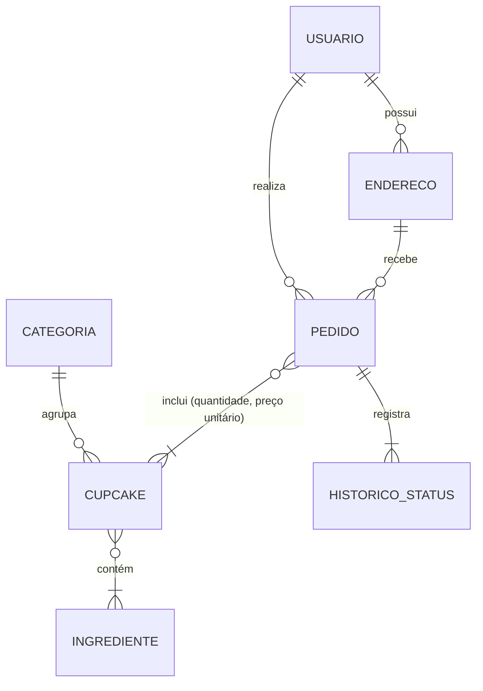
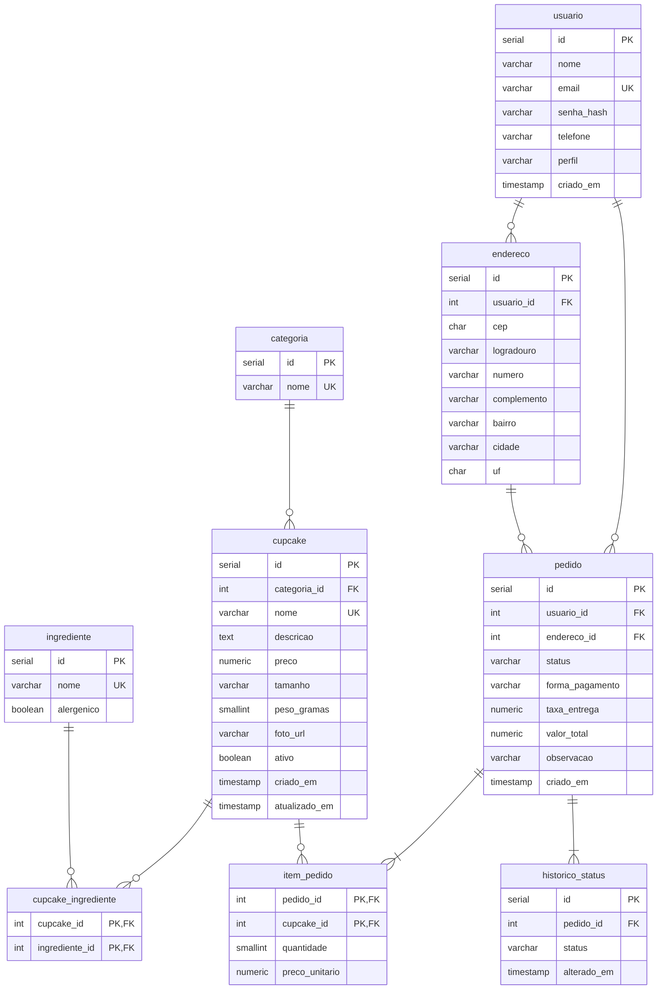

# 4. Projeto de Banco de Dados – CupcakeApp

**SGBD escolhido:** PostgreSQL 14 ou superior.

**Por que PostgreSQL:** é gratuito e de código aberto, está entre os SGBDs mais usados no mercado e é suportado por todas as linguagens do PI II (Java, PHP, C#, Python). Também tem planos gratuitos de hospedagem (Render, Supabase, Neon), o que facilita colocar o sistema no ar para os testes da Etapa 3. Além disso, oferece `CHECK`, gatilhos e visões, recursos usados aqui para garantir as regras de negócio dentro do próprio banco.

Os modelos foram derivados do **Diagrama de Classes de Persistência** (documento 02, seção 2.2.1), seguindo o caminho: classes → modelo conceitual → modelo lógico normalizado → modelo físico.

---

## 4.1 Modelo Conceitual (DER)

O modelo conceitual mostra as entidades e os relacionamentos com suas cardinalidades, sem detalhes de implementação.

<sub>🖼 Versão em imagem: [der-conceitual.png](diagramas/der-conceitual.png)</sub>



**Leitura das cardinalidades**
- Um **usuário** possui zero ou mais **endereços** e realiza zero ou mais **pedidos**.
- Um **pedido** é entregue em exatamente um **endereço** e inclui um ou mais **cupcakes**. Esse relacionamento N:N tem atributos próprios: **quantidade** e **preço unitário**.
- Um **cupcake** pertence a exatamente uma **categoria** e contém um ou mais **ingredientes**. Um ingrediente pode estar em vários cupcakes (N:N).
- Cada **pedido** tem um ou mais registros de **histórico de status**.

## 4.2 Modelo Lógico (relacional normalizado)

Notação: **sublinhado** = chave primária (PK); *itálico* = chave estrangeira (FK).

- USUARIO (<u>id</u>, nome, email, senha_hash, telefone, perfil, criado_em)
- ENDERECO (<u>id</u>, *usuario_id*, cep, logradouro, numero, complemento, bairro, cidade, uf)
- CATEGORIA (<u>id</u>, nome)
- CUPCAKE (<u>id</u>, *categoria_id*, nome, descricao, preco, tamanho, peso_gramas, foto_url, ativo, criado_em, atualizado_em)
- INGREDIENTE (<u>id</u>, nome, alergenico)
- CUPCAKE_INGREDIENTE (<u>*cupcake_id*, *ingrediente_id*</u>)
- PEDIDO (<u>id</u>, *usuario_id*, *endereco_id*, status, forma_pagamento, taxa_entrega, valor_total, observacao, criado_em)
- ITEM_PEDIDO (<u>*pedido_id*, *cupcake_id*</u>, quantidade, preco_unitario)
- HISTORICO_STATUS (<u>id</u>, *pedido_id*, status, alterado_em)

<sub>🖼 Versão em imagem: [der-logico.png](diagramas/der-logico.png)</sub>



### 4.2.1 Normalização

| Forma normal | Regra | Como o modelo atende |
|---|---|---|
| **1FN** | Todos os atributos são atômicos, sem listas ou grupos repetidos. | No PI I, os "ingredientes" eram um texto livre ("farinha, ovos, leite…"), o que viola a 1FN. Eles viraram a tabela `ingrediente`, ligada pela tabela associativa `cupcake_ingrediente`. O endereço também foi separado em campos (cep, logradouro, número…), em vez de um texto único. Os itens do pedido ficam em `item_pedido`, e não em colunas como item1, item2… |
| **2FN** | Está na 1FN e todo atributo não chave depende da chave **inteira**. | As únicas chaves compostas são `item_pedido (pedido_id, cupcake_id)` e `cupcake_ingrediente`. Em `item_pedido`, `quantidade` e `preco_unitario` dependem do par pedido + cupcake, e não de só um deles. O nome e a descrição do cupcake **não** foram repetidos nessa tabela, porque dependeriam apenas de `cupcake_id`. |
| **3FN** | Está na 2FN e não há dependências transitivas (atributo não chave dependendo de outro atributo não chave). | O nome da categoria fica em `categoria`, e não repetido em cada cupcake. Os dados do cliente não são copiados para o pedido, só o `usuario_id`. O alergênico é uma propriedade do ingrediente, e não do cupcake. |

### 4.2.2 Desnormalizações conscientes

Dois campos parecem redundantes, mas foram mantidos **de propósito**:

| Campo | Por que não é redundância |
|---|---|
| `item_pedido.preco_unitario` | Guarda o preço **no momento da compra** (RN05). Se o administrador mudar o preço do cupcake amanhã, os pedidos antigos continuam com o valor que o cliente realmente pagou. Esse dado é histórico, e não uma cópia de `cupcake.preco`. |
| `pedido.valor_total` | Poderia ser calculado somando os itens, mas é gravado para manter o valor exato cobrado, para deixar a listagem "Meus pedidos" mais rápida e para servir de conferência. A aplicação calcula o valor pela RN06 antes de gravar, e os testes unitários verificam essa conta. |

## 4.3 Modelo Físico

O modelo físico está implementado no script **[`database/schema.sql`](../../database/schema.sql)**, e os dados de exemplo estão em **[`database/seed.sql`](../../database/seed.sql)**.

### 4.3.1 Como criar o banco

```bash
createdb cupcakeapp
psql -d cupcakeapp -f database/schema.sql
psql -d cupcakeapp -f database/seed.sql
```

O seed cria dois usuários de teste:

| E-mail | Senha | Perfil |
|---|---|---|
| admin@cupcakeapp.com.br | Admin@2026 | ADMIN |
| mariana@email.com | Cupcake@123 | CLIENTE |

Ele também cria 4 categorias, 18 ingredientes, 6 cupcakes e 2 pedidos de exemplo.

### 4.3.2 Recursos usados no projeto físico

| Recurso | Onde | Finalidade |
|---|---|---|
| `PRIMARY KEY` / `FOREIGN KEY` | Todas as tabelas | Integridade referencial |
| `ON DELETE CASCADE` | endereco, cupcake_ingrediente, item_pedido, historico_status | Apagar o "pai" apaga os dados que só existem por causa dele |
| `ON DELETE RESTRICT` | cupcake ← item_pedido, usuario ← pedido, categoria ← cupcake | Impede apagar dados que já foram usados (RN11), preservando o histórico |
| `UNIQUE` | usuario.email, cupcake.nome, categoria.nome, ingrediente.nome | Evita duplicidade (RN08) |
| `CHECK` | preço > 0, quantidade 1–20, CEP com 8 dígitos, UF, e-mail, foto e descrição não vazias, listas de status/perfil/tamanho/pagamento | Restringe o **domínio** de cada atributo, garantindo RN01, RN02 e RN03 dentro do banco |
| Gatilho `tg_pedido_status` | pedido | Bloqueia transições de status inválidas (RN07) e grava cada mudança em `historico_status` automaticamente |
| Gatilho `tg_cupcake_atualizado` | cupcake | Atualiza `atualizado_em` a cada edição |
| Visão `vw_catalogo` | – | Entrega o catálogo público, só com os ativos (RN04), já indicando se o cupcake contém alergênicos (US05) |
| Índices | ver o script | Deixam rápidas as consultas mais frequentes: catálogo por categoria, busca por nome, pedidos do cliente e pedidos por status |
| `pgcrypto` / bcrypt | seed.sql | Hash das senhas (RN09) |

### 4.3.3 Validação do script

O script foi executado num PostgreSQL 16 real. Em seguida, foram feitas tentativas de gravar dados inválidos para confirmar que o banco os rejeita:

| Teste | Regra | Resultado |
|---|---|---|
| Inserir cupcake com `foto_url` vazia | RN01 | ❌ Rejeitado (`cupcake_foto_url_check`) ✅ |
| Inserir cupcake com descrição em branco | RN01 | ❌ Rejeitado (`cupcake_descricao_check`) ✅ |
| Inserir cupcake com preço 0 | RN02 | ❌ Rejeitado (`cupcake_preco_check`) ✅ |
| Inserir item com 21 unidades | RN03 | ❌ Rejeitado (`item_pedido_quantidade_check`) ✅ |
| Mudar pedido de ENTREGUE para RECEBIDO | RN07 | ❌ Rejeitado ("Transição de status inválida") ✅ |
| Mudar pedido de RECEBIDO direto para ENTREGUE | RN07 | ❌ Rejeitado ✅ |
| Cancelar pedido com status RECEBIDO | RN07 | ✔ Aceito ✅ |
| Cadastrar e-mail repetido | RN08 | ❌ Rejeitado (`uk_usuario_email`) ✅ |
| Excluir cupcake que já foi vendido | RN11 | ❌ Rejeitado (`fk_item_cupcake`) ✅ |
| Endereço com CEP "123" | MSG06 | ❌ Rejeitado (`endereco_cep_check`) ✅ |
| Login com a senha correta / errada | RN09 | 1 registro / 0 registros ✅ |
| Histórico do pedido 1 após 3 mudanças | US08 | 4 registros gravados automaticamente ✅ |

> **Observação:** a aplicação (Etapa 2) também valida esses dados antes de enviá-los ao banco, para exibir as mensagens amigáveis do catálogo de mensagens. As restrições do banco são uma **segunda camada de proteção**: mesmo que haja um erro no código, dados inválidos não entram.

O dicionário de dados completo está no documento **[05-dicionario-de-dados.md](05-dicionario-de-dados.md)**.
