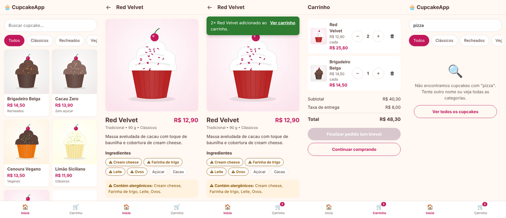
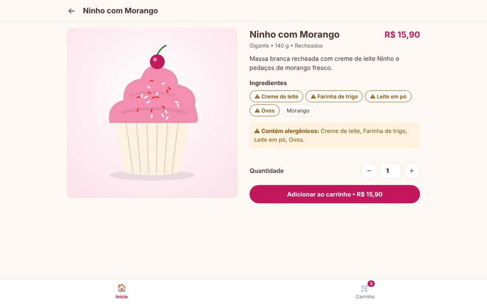

# Etapa 2 – Desenvolvimento

**Projeto Integrador Transdisciplinar em Engenharia de Software II – Situação-Problema 2**
**Aluno:** Guilherme França Demetino – RGM 33160236

## Tecnologias

| Camada | Tecnologia | Por quê |
|---|---|---|
| Front-end | HTML5, CSS3 e JavaScript (sem frameworks) | Pedido no enunciado. O site funciona mesmo sem JavaScript: o JS só melhora a experiência (seletor de quantidade, total no botão e avisos que somem sozinhos). |
| Back-end | **Python 3.11+ com Flask**, no padrão **MVC** | Código curto e legível, e o padrão MVC fica visível na estrutura de pastas. |
| Banco | **PostgreSQL 14+** com o driver **psycopg 3** | Definido na Etapa 1. Todas as consultas usam parâmetros (`%s`), o que protege contra SQL Injection (RNF05). |
| Testes | **Pytest** | Testes unitários do model e testes de integração que usam o banco real e simulam o navegador. |

## Arquitetura MVC

```
app/
├── __init__.py              ← cria a aplicação e registra os controllers
├── db.py                    ← conexão com o PostgreSQL (uma por requisição)
├── messages.py              ← catálogo de mensagens MSG01…MSG99 (o mesmo da Etapa 1)
├── models/                  ← M: regras de negócio e acesso aos dados
│   ├── cupcake_model.py     ←   consultas do catálogo (US03, US04, US05)
│   └── carrinho.py          ←   classe Carrinho: RN03, RN04, RN06 (US06)
├── controllers/             ← C: recebem a requisição, chamam o model e escolhem a view
│   ├── catalogo_controller.py
│   └── carrinho_controller.py
├── templates/               ← V: telas em HTML (Jinja2)
│   ├── base.html  catalogo.html  detalhe.html  carrinho.html  erro.html
└── static/                  ← CSS, JavaScript e imagens
tests/                       ← testes automatizados (Pytest)
```

**Fluxo de uma requisição** (igual ao diagrama de sequência da Etapa 1): o navegador pede `/cupcakes/1` → o `catalogo_controller.detalhe()` chama `cupcake_model.buscar_ativo_por_id(1)` → o model consulta o PostgreSQL → o controller entrega os dados para o template `detalhe.html` → o HTML volta para o navegador.

## Como rodar no seu computador

**Pré-requisitos:** Python 3.11 ou superior e PostgreSQL 14 ou superior instalados.

```bash
# 1. Baixar o projeto
git clone https://github.com/Guilherme-demetino/cupcakes-app.git
cd cupcakes-app

# 2. Criar o ambiente virtual e instalar as dependências
python -m venv .venv
.venv\Scripts\activate          # Windows
# source .venv/bin/activate     # Linux / macOS
pip install -r requirements.txt

# 3. Configurar o banco
#    Crie dois bancos vazios no PostgreSQL (pelo pgAdmin ou pelo terminal):
createdb -U postgres cupcakeapp
createdb -U postgres cupcakeapp_test
#    Copie .env.example para .env e coloque a senha do seu PostgreSQL nas URLs.

# 4. Criar as tabelas e os dados de exemplo
flask --app run init-db

# 5. Rodar
flask --app run run --debug
#    Abra http://127.0.0.1:5000
```

**Rodar os testes:**
```bash
pytest
```

## Andamento por sprint

### Sprint 1 – Catálogo, detalhes e carrinho ✅

| História | O que foi feito | Arquivos principais |
|---|---|---|
| **US03** Ver catálogo | Grade de cupcakes ativos com foto, nome, preço e categoria. Mostra MSG10 quando não há produtos. | `catalogo_controller.index`, `cupcake_model.listar_ativos`, `catalogo.html` |
| **US04** Filtrar e buscar | Categorias em formato de "chips" e busca por nome sem diferenciar maiúsculas de minúsculas. Os dois podem ser usados juntos. Mostra MSG11 quando não há resultado. | idem |
| **US05** Ver detalhes *(história do PI I)* | Foto, descrição, tamanho, peso, ingredientes com os **alergênicos destacados**, aviso "Contém alergênicos", seletor de quantidade de 1 a 20 e botão com o total. Mostra MSG12 para cupcake inexistente ou inativo. | `catalogo_controller.detalhe`, `cupcake_model.buscar_ativo_por_id`, `detalhe.html`, `app.js` |
| **US06** Gerenciar carrinho *(adiantada da Sprint 2)* | Adicionar (soma sem duplicar), alterar quantidade, remover com **Desfazer**, subtotal, taxa de entrega e total. Limite de 20 unidades (MSG13). Itens desativados saem do carrinho (MSG15). O carrinho fica na sessão e não vai para o banco, como definido no diagrama de classes. | `carrinho.py`, `carrinho_controller.py`, `carrinho.html` |


*Catálogo, detalhes com alergênicos, confirmação "adicionado ao carrinho" (MSG20), carrinho com total e busca sem resultado (MSG11).*


*No computador, a tela de detalhes se reorganiza em duas colunas (RNF02, layout responsivo).*

**Testes da Sprint 1: 45 testes, todos passando.**

| Arquivo | Tipo | Qtd. | O que verifica |
|---|---|---|---|
| `tests/test_carrinho_model.py` | Unitário (sem banco) | 17 | RN03 (limite de 1 a 20), RN04 (inativos saem), RN06 (cálculo exato do total com `Decimal`), soma sem duplicar, remover/desfazer |
| `tests/test_cupcake_model.py` | Integração com o PostgreSQL | 9 | Só ativos no catálogo, filtro, busca sem diferenciar maiúsculas, busca com `%` e `_` tratados como texto, ingredientes e alergênicos |
| `tests/test_rotas.py` | Integração (simula o navegador) | 19 | Cada critério de aceitação da US03 à US06, as mensagens MSG10 a MSG20, erro 404 amigável e proteção contra XSS na busca |

**Os testes realmente detectam erros?** Para conferir, quebrei o código de propósito. Com a taxa de entrega trocada para R$ 9,00 e o limite de 20 unidades removido, **8 testes falharam**. Ao fazer o catálogo mostrar cupcakes inativos, **2 testes falharam**. Depois de desfazer as mudanças, os 45 voltaram a passar.

**Observações:**
- As imagens dos cupcakes são **ilustrações provisórias** em WebP, com cerca de 5 KB cada (RNF01: ≤ 200 KB). Para trocar pelas fotos reais, basta salvar os arquivos com o mesmo nome em `app/static/img/cupcakes/`.
- O botão "Finalizar pedido" aparece desativado, com o texto "em breve", até a Sprint 3 (US07).

### Sprint 2 – Cadastro e login (US01, US02) ⏳
### Sprint 3 – Checkout e acompanhamento de pedidos (US07, US08, US09) ⏳
### Sprint 4 – Área administrativa (US10, US11) ⏳
### Manual de uso ⏳
