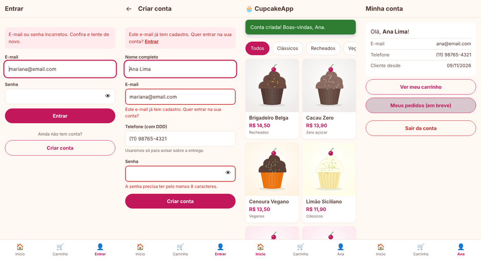
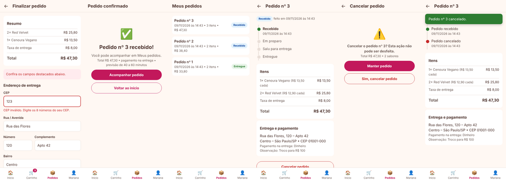
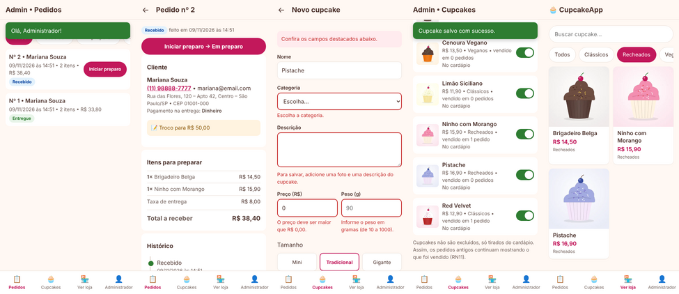

# Etapa 2 – Desenvolvimento

**Projeto Integrador Transdisciplinar em Engenharia de Software II – Situação-Problema 2**
**Aluno:** Guilherme França Demetino – RGM 33160236

## Tecnologias

| Camada | Tecnologia | Por quê |
|---|---|---|
| Front-end | HTML5, CSS3 e JavaScript (sem frameworks) | Pedido no enunciado. O site funciona mesmo sem JavaScript: o JS só melhora a experiência (seletor de quantidade, total no botão e avisos que somem sozinhos). |
| Back-end | **Python 3.11+ com Flask**, no padrão **MVC** | Código curto e legível, e o padrão MVC fica visível na estrutura de pastas. |
| Banco | **PostgreSQL 14+** com o driver **psycopg 3** | Definido na Etapa 1. Todas as consultas usam parâmetros (`%s`), o que protege contra SQL Injection (RNF05). |
| Testes | **Pytest** | Testes unitários do model e testes de integração que usam o banco real e simulam o navegador. |

## Arquitetura MVC

```
app/
├── __init__.py              ← cria a aplicação e registra os controllers
├── db.py                    ← conexão com o PostgreSQL (uma por requisição)
├── messages.py              ← catálogo de mensagens MSG01…MSG99 (o mesmo da Etapa 1)
├── models/                  ← M: regras de negócio e acesso aos dados
│   ├── cupcake_model.py     ←   consultas do catálogo (US03, US04, US05)
│   ├── carrinho.py          ←   classe Carrinho: RN03, RN04, RN06 (US06)
│   ├── usuario_model.py     ←   cadastro e login, senha com bcrypt (US01, US02, RN08, RN09)
│   └── pedido_model.py      ←   checkout, pedidos e cancelamento (US07–US09, RN05, RN06, RN07, RN10)
├── controllers/             ← C: recebem a requisição, chamam o model e escolhem a view
│   ├── catalogo_controller.py
│   ├── carrinho_controller.py
│   ├── auth_controller.py
│   ├── pedido_controller.py
│   └── admin_controller.py   ← área administrativa (US10, US11)
├── auth.py                  ← quem está logado; decorators @login_obrigatorio e @admin_obrigatorio
├── uploads.py               ← validação e gravação das fotos enviadas pelo administrador
├── templates/               ← V: telas em HTML (Jinja2)
│   ├── base.html  catalogo.html  detalhe.html  carrinho.html  erro.html
│   ├── login.html  cadastro.html  conta.html  _campo.html
│   ├── checkout.html  confirmacao.html  pedidos.html  pedido.html  cancelar.html
│   └── admin/  cupcakes.html  cupcake_form.html  pedidos.html  pedido.html
└── static/                  ← CSS, JavaScript e imagens
tests/                       ← testes automatizados (Pytest)
```

**Fluxo de uma requisição** (igual ao diagrama de sequência da Etapa 1): o navegador pede `/cupcakes/1` → o `catalogo_controller.detalhe()` chama `cupcake_model.buscar_ativo_por_id(1)` → o model consulta o PostgreSQL → o controller entrega os dados para o template `detalhe.html` → o HTML volta para o navegador.

## Como rodar no seu computador

**Pré-requisitos:** Python 3.11 ou superior e PostgreSQL 14 ou superior instalados.

```bash
# 1. Baixar o projeto
git clone https://github.com/Guilherme-demetino/cupcakes-app.git
cd cupcakes-app

# 2. Criar o ambiente virtual e instalar as dependências
python -m venv .venv
.venv\Scripts\activate          # Windows
# source .venv/bin/activate     # Linux / macOS
pip install -r requirements.txt

# 3. Configurar o banco
#    Crie dois bancos vazios no PostgreSQL (pelo pgAdmin ou pelo terminal):
createdb -U postgres cupcakeapp
createdb -U postgres cupcakeapp_test
#    Copie .env.example para .env e coloque a senha do seu PostgreSQL nas URLs.

# 4. Criar as tabelas e os dados de exemplo
flask --app run init-db

# 5. Rodar
flask --app run run --debug
#    Abra http://127.0.0.1:5000
```

**Rodar os testes:**
```bash
pytest
```

## Andamento por sprint

### Sprint 1 – Catálogo, detalhes e carrinho ✅

| História | O que foi feito | Arquivos principais |
|---|---|---|
| **US03** Ver catálogo | Grade de cupcakes ativos com foto, nome, preço e categoria. Mostra MSG10 quando não há produtos. | `catalogo_controller.index`, `cupcake_model.listar_ativos`, `catalogo.html` |
| **US04** Filtrar e buscar | Categorias em formato de "chips" e busca por nome sem diferenciar maiúsculas de minúsculas. Os dois podem ser usados juntos. Mostra MSG11 quando não há resultado. | idem |
| **US05** Ver detalhes *(história do PI I)* | Foto, descrição, tamanho, peso, ingredientes com os **alergênicos destacados**, aviso "Contém alergênicos", seletor de quantidade de 1 a 20 e botão com o total. Mostra MSG12 para cupcake inexistente ou inativo. | `catalogo_controller.detalhe`, `cupcake_model.buscar_ativo_por_id`, `detalhe.html`, `app.js` |
| **US06** Gerenciar carrinho *(adiantada da Sprint 2)* | Adicionar (soma sem duplicar), alterar quantidade, remover com **Desfazer**, subtotal, taxa de entrega e total. Limite de 20 unidades (MSG13). Itens desativados saem do carrinho (MSG15). O carrinho fica na sessão e não vai para o banco, como definido no diagrama de classes. | `carrinho.py`, `carrinho_controller.py`, `carrinho.html` |


*Catálogo, detalhes com alergênicos, confirmação "adicionado ao carrinho" (MSG20), carrinho com total e busca sem resultado (MSG11).*


*No computador, a tela de detalhes se reorganiza em duas colunas (RNF02, layout responsivo).*

**Testes da Sprint 1: 45 testes, todos passando.** *(veja o total acumulado na seção "Testes automatizados")*

| Arquivo | Tipo | Qtd. | O que verifica |
|---|---|---|---|
| `tests/test_carrinho_model.py` | Unitário (sem banco) | 17 | RN03 (limite de 1 a 20), RN04 (inativos saem), RN06 (cálculo exato do total com `Decimal`), soma sem duplicar, remover/desfazer |
| `tests/test_cupcake_model.py` | Integração com o PostgreSQL | 9 | Só ativos no catálogo, filtro, busca sem diferenciar maiúsculas, busca com `%` e `_` tratados como texto, ingredientes e alergênicos |
| `tests/test_rotas.py` | Integração (simula o navegador) | 19 | Cada critério de aceitação da US03 à US06, as mensagens MSG10 a MSG20, erro 404 amigável e proteção contra XSS na busca |

**Os testes realmente detectam erros?** Para conferir, quebrei o código de propósito. Com a taxa de entrega trocada para R$ 9,00 e o limite de 20 unidades removido, **8 testes falharam**. Ao fazer o catálogo mostrar cupcakes inativos, **2 testes falharam**. Depois de desfazer as mudanças, os 45 voltaram a passar.

**Observações:**
- As imagens dos cupcakes são **ilustrações provisórias** em WebP, com cerca de 5 KB cada (RNF01: ≤ 200 KB). Para trocar pelas fotos reais, basta salvar os arquivos com o mesmo nome em `app/static/img/cupcakes/`.
- O botão "Finalizar pedido" ficou desativado até a Sprint 3, quando passou a funcionar.

### Sprint 2 – Cadastro e login (US01, US02) ✅

| História | O que foi feito | Arquivos principais |
|---|---|---|
| **US01** Cadastrar-se | Formulário com nome, e-mail, telefone (com máscara) e senha (com botão de mostrar/ocultar). Os erros aparecem abaixo de cada campo, todos de uma vez: MSG01 (vazio), MSG02 (e-mail inválido), MSG03 (e-mail já cadastrado, com link para entrar), MSG04 (senha curta) e MSG23 (telefone sem DDD). O que foi digitado é mantido no formulário, **exceto a senha**. Depois de cadastrar, o cliente já entra logado. | `usuario_model.validar_cadastro`, `usuario_model.criar`, `auth_controller.cadastro`, `cadastro.html` |
| **US02** Login e logout | Login por e-mail e senha. Se algo estiver errado, mostra sempre a mesma mensagem (MSG05), sem revelar se o e-mail existe. Depois do login, volta para a página de origem, como o carrinho. O **carrinho é mantido** ao entrar. O botão "Sair" encerra a sessão. | `usuario_model.autenticar`, `auth.py`, `auth_controller.login/logout`, `login.html` |
| *Extra* Minha conta | Página com os dados do cliente, acessível só para quem está logado. A barra inferior mostra "Entrar" ou o primeiro nome do cliente. | `auth_controller.conta`, `conta.html` |
| *Base para a Sprint 4* | Os decorators `@login_obrigatorio` e `@admin_obrigatorio` já ficaram prontos e testados. Um cliente que tenta abrir uma página de administrador vê MSG17 (RNF06). | `auth.py` |


*Login com senha errada (MSG05), cadastro mostrando e-mail repetido e senha curta ao mesmo tempo, boas-vindas depois do cadastro e "Minha conta".*

**Segurança aplicada nesta sprint:**

| Risco | Proteção | Teste que comprova |
|---|---|---|
| Vazamento de senhas | Hash **bcrypt** gerado pelo PostgreSQL (`crypt` + `gen_salt('bf')`). A senha nunca é gravada nem devolvida para a tela. (RN09) | `test_criar_usuario_grava_hash_bcrypt_e_nao_a_senha`, `test_cadastro_com_erro_mantem_dados_mas_nunca_a_senha` |
| Descobrir quais e-mails têm conta | Mesma resposta para e-mail inexistente ou senha errada | `test_login_nao_revela_se_o_email_existe` |
| *Open redirect* (mandar o cliente para um site falso depois do login) | `destino_seguro()` só aceita endereços internos | `test_login_nao_redireciona_para_site_externo`, `test_destino_seguro` |
| Outro site deslogar ou agir pelo cliente | O logout só funciona por POST, e o cookie da sessão é `SameSite=Lax` e `HttpOnly` | `test_logout_nao_funciona_por_get` |
| XSS (código malicioso no nome) | O Jinja2 trata tudo o que o usuário digita como texto | `test_nome_com_html_e_exibido_como_texto` |
| Cliente acessar a área do administrador | `@admin_obrigatorio` → MSG17, com status 403 | `test_area_admin_bloqueia_cliente_com_msg17` |

**Os testes de segurança pegam as falhas?** Introduzi quatro falhas de propósito e rodei os testes de novo:

| Falha introduzida | Testes que falharam |
|---|---|
| Login que ignora a senha | 17 |
| Redirecionamento para qualquer site | 2 |
| Cliente com acesso à área do administrador | 1 |
| Senha gravada em texto puro | 1 |

Depois de desfazer as mudanças, os 96 testes voltaram a passar.

**Para entrar no sistema durante os testes**, use as contas do `seed.sql`: `mariana@email.com` / `Cupcake@123` (cliente) e `admin@cupcakeapp.com.br` / `Admin@2026` (administrador).

**Limitação conhecida:** ainda não há bloqueio depois de muitas tentativas de login erradas. Isso fica registrado como melhoria futura.

### Sprint 3 – Checkout e acompanhamento de pedidos (US07, US08, US09) ✅

| História | O que foi feito | Arquivos principais |
|---|---|---|
| **US07** Finalizar pedido | O botão "Finalizar pedido" do carrinho leva ao checkout. Quem não está logado vai para o login e volta com o carrinho intacto. O endereço vem preenchido com o último usado, e o CEP preenche rua, bairro e cidade automaticamente (ViaCEP). O cliente escolhe o pagamento na entrega (PIX, cartão ou dinheiro) e pode deixar uma observação. Pedido, itens e endereço são gravados numa **única transação**: ou grava tudo, ou nada. O carrinho é esvaziado e aparece a confirmação com o número do pedido (MSG21). | `pedido_model.criar`, `pedido_controller.checkout/confirmar`, `checkout.html`, `confirmacao.html` |
| **US08** Meus pedidos | Lista do mais recente para o mais antigo, com data, quantidade de itens, total e um selo colorido de status. O detalhe mostra a **linha do tempo** com data e hora de cada etapa, os itens com o preço pago, o endereço, a forma de pagamento e a observação. | `pedido_model.listar_do_usuario/buscar_do_usuario`, `pedidos.html`, `pedido.html` |
| **US09** Cancelar pedido | O botão aparece só enquanto o pedido está **Recebido**. Antes de cancelar, o sistema pede confirmação (MSG18). O cancelamento é um `UPDATE` com condição, então dois cliques ao mesmo tempo não causam problema. | `pedido_model.cancelar_pelo_cliente`, `cancelar.html` |


*Checkout com CEP inválido (MSG06), confirmação (MSG21), Meus pedidos, detalhe com linha do tempo, confirmação de cancelamento (MSG18) e pedido cancelado.*

**Regras de negócio aplicadas e testadas:**

| Regra | Como foi garantida | Teste que comprova |
|---|---|---|
| RN05 Preço congelado | O preço do momento da compra é gravado em `item_pedido.preco_unitario` | `test_preco_fica_congelado_no_pedido`: o preço do cupcake muda depois e o pedido não muda |
| RN06 Total | Calculado pela classe `Carrinho` e gravado em `pedido.valor_total` | `test_finalizar_pedido_com_sucesso`: 2× 12,90 + 1× 14,50 + 8,00 = **R$ 48,30** |
| RN07 Status | `pode_mudar_status()` no código + gatilho no banco | 11 combinações testadas em `test_pode_mudar_status` |
| RN10 Login e endereço | `@login_obrigatorio` + validação MSG06/MSG07 | `test_checkout_sem_login_vai_para_login_e_volta`, `test_cep_invalido_mostra_msg06_e_nao_grava` |
| RN04 Item que saiu do cardápio | O carrinho é conferido de novo ao confirmar; o cliente volta ao carrinho com MSG15 e nada é gravado | `test_cupcake_desativado_durante_a_compra_mostra_msg15` |
| Privacidade | Um cliente nunca vê nem cancela o pedido de outro. A resposta é 404, sem revelar que o número existe | `test_cliente_nao_ve_pedido_de_outro_cliente` |
| Pedido duplicado | O carrinho é esvaziado ao gravar, e o botão é desativado depois do clique | `test_enviar_o_pedido_duas_vezes_nao_duplica` |

**Os testes pegam as falhas?** Introduzi cinco falhas de propósito e rodei os testes de novo:

| Falha introduzida | Testes que falharam |
|---|---|
| Mostrar o preço atual em vez do preço pago (RN05) | 1 |
| Cliente consegue ver o pedido de outro | 11 |
| Cancelar um pedido que já está em preparo (RN07) | 2 |
| Gravar o total sem a taxa de entrega (RN06) | 3 |
| Aceitar CEP incompleto | 4 |

Depois de desfazer as mudanças, todos voltaram a passar.

**Observação:** o preenchimento pelo CEP usa o serviço gratuito ViaCEP direto no navegador. Se ele estiver fora do ar, nada quebra e o cliente digita o endereço normalmente. Esse recurso precisa de internet, por isso não pôde ser testado no ambiente usado para os testes automáticos. Vale conferir manualmente.

### Sprint 4 – Área administrativa (US10, US11) ✅

Entre com `admin@cupcakeapp.com.br` / `Admin@2026`. O administrador cai direto na lista de pedidos e tem um menu próprio: Pedidos, Cupcakes, Ver loja e Conta.

| História | O que foi feito | Arquivos principais |
|---|---|---|
| **US10** Manter cupcakes | A lista mostra todos os cupcakes, ativos e inativos, com quantas vezes cada um foi vendido. Um interruptor tira ou coloca o cupcake no cardápio (RN04). O formulário serve para criar e para editar: nome, categoria, descrição, preço (aceita "16,90"), peso, tamanho, foto com **pré-visualização** e ingredientes, com os alergênicos marcados. Na edição, se nenhuma foto for enviada, a atual é mantida. **Não há botão de excluir**: cupcakes vendidos ficam no histórico (RN11). | `cupcake_model.validar_cupcake/salvar/alternar_ativo`, `uploads.py`, `admin/cupcakes.html`, `admin/cupcake_form.html` |
| **US11** Gerenciar pedidos | A lista tem filtro por status e mostra a contagem de cada um. Os pedidos em andamento aparecem primeiro, e cada um tem um **botão rápido** para o próximo passo ("Iniciar preparo", "Despachar", "Confirmar entrega"). O detalhe mostra o cliente com o **telefone clicável**, o endereço, a forma de pagamento, a observação em destaque, os itens a preparar e o histórico. O cancelamento pede confirmação e só aparece quando a RN07 permite. | `pedido_model.listar_todos/buscar_admin/mudar_status_admin`, `admin/pedidos.html`, `admin/pedido.html` |


*Lista de pedidos, detalhe para a cozinha e a entrega, formulário barrando um cupcake incompleto (MSG08/MSG09), lista de cupcakes depois de salvar (MSG22) e o novo cupcake já aparecendo na loja.*

**Regras e proteções desta sprint:**

| Regra | Como foi garantida | Teste que comprova |
|---|---|---|
| RNF06 Só o administrador acessa | `@admin_obrigatorio` em todas as rotas `/admin`: visitante vai para o login, cliente recebe MSG17 (403) | `test_cliente_recebe_msg17` (6 rotas), `test_cliente_nao_consegue_mudar_status_nem_cadastrar` |
| RN01 Foto e descrição | `validar_cupcake` (MSG08) + `CHECK` no banco | `test_cadastrar_sem_foto_mostra_msg08_e_nao_grava` |
| RN02 Preço > 0 | MSG09; aceita vírgula e separador de milhar | `test_preco_maior_que_zero_msg09` (9 casos) |
| RNF01 Foto ≤ 200 KB | `uploads.py` recusa arquivos maiores, e o Flask corta envios acima de 2 MB | `test_foto_acima_de_200kb_e_recusada` |
| Upload seguro | O tipo é conferido pelo **conteúdo** do arquivo, não pelo nome, e o nome é gerado pelo sistema (ninguém sobrescreve arquivos) | `test_arquivo_que_nao_e_imagem_e_recusado` (um script PHP renomeado para .webp é recusado) |
| RN07 Fluxo de status | `pode_mudar_status()` no código + gatilho no banco (duas camadas) | `test_nao_pula_etapas_msg16`, `test_gatilho_do_banco_tambem_protege`, `test_nao_cancela_pedido_que_saiu_para_entrega` |
| Dois funcionários ao mesmo tempo | O `UPDATE` só acontece se o status ainda for o que estava na tela; se outra pessoa já mudou, aparece um aviso e nada é sobrescrito | `test_dois_funcionarios_ao_mesmo_tempo` |
| RN05 / RN11 | Editar o preço não altera pedidos antigos; desativar não apaga o histórico | `test_editar_sem_enviar_foto_mantem_a_atual`, `test_tirar_e_voltar_ao_cardapio` |

**Os testes pegam as falhas?** Introduzi seis falhas de propósito e rodei os testes de novo:

| Falha introduzida | Testes que falharam |
|---|---|
| Cliente com acesso à área do administrador | 7 |
| Aceitar qualquer arquivo como foto | 1 |
| Sem o limite de 200 KB | 1 |
| Cupcake sem foto (RN01) | 2 |
| Pular etapas do pedido (RN07) | 2 |
| Sobrescrever a mudança feita por outro funcionário | 4 |

Depois de desfazer as mudanças, os 203 testes voltaram a passar.

**Teste de ponta a ponta:** `test_pedido_do_cliente_aparece_para_o_admin` junta as quatro sprints. O cliente entra, compra 4 Cacau Zero e finaliza com observação. Depois o administrador entra e vê o pedido com os itens, a observação e o total certo (R$ 63,60).

**Melhorias futuras (fora do escopo):** cadastrar novos ingredientes e categorias pela tela (hoje usa os do banco), apagar fotos antigas que não são mais usadas e paginar a lista de pedidos quando ela ficar grande.

## Testes automatizados (total acumulado)

**203 testes, todos passando.** Para rodar: `pytest`.

| Arquivo | Tipo | Qtd. | Sprint |
|---|---|---|---|
| `tests/test_carrinho_model.py` | Unitário | 17 | 1 |
| `tests/test_cupcake_model.py` | Integração (PostgreSQL) | 9 | 1 |
| `tests/test_rotas.py` | Integração (simula o navegador) | 19 | 1 |
| `tests/test_usuario_model.py` | Unitário + integração | 30 | 2 |
| `tests/test_rotas_auth.py` | Integração (simula o navegador) | 21 | 2 |
| `tests/test_pedido_model.py` | Unitário + integração | 34 | 3 |
| `tests/test_rotas_pedido.py` | Integração (simula o navegador) | 18 | 3 |
| `tests/test_admin.py` | Unitário + integração | 55 | 4 |

### Manual de uso ⏳
