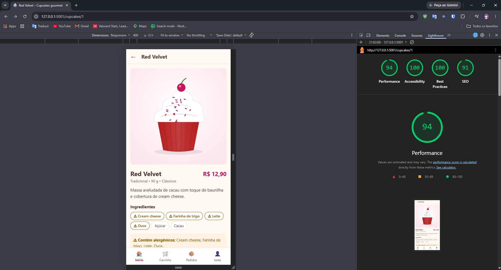

# 1. Verificação e Validação – CupcakeApp

**Projeto Integrador Transdisciplinar em Engenharia de Software II – Situação-Problema 3**
**Aluno:** Guilherme França Demetino – RGM 33160236

Este documento mostra, com evidências, que o comportamento esperado foi alcançado. Ele separa os dois conceitos vistos no material da disciplina:

- **Verificação:** o software foi construído **conforme a especificação**, ou seja, as histórias, regras e requisitos da Etapa 1? A pergunta é *"construímos o produto do jeito certo?"*.
- **Validação:** o software atende **a quem vai usá-lo**? A pergunta é *"construímos o produto certo?"*. Ela é feita com usuários reais: os 5 colegas da [avaliação](02-formulario-de-avaliacao.md).

---

## 1.1 Estratégia: Modelo V

Cada nível de desenvolvimento da Etapa 1 tem um nível de teste correspondente:

| Desenvolvimento (Etapa 1 e 2) | ⟷ | Teste correspondente | Como foi feito | Resultado |
|---|---|---|---|---|
| **Requisitos** (histórias US01–US12, RN, RNF) | ⟷ | **Teste de aceitação** | 5 colegas usam o sistema publicado e preenchem o formulário de avaliação | 🟡 4 de 5 recebidas ([seção 1.6](#16-validação-com-usuários-teste-de-aceitação)) |
| **Análise** (casos de uso, critérios de aceitação) | ⟷ | **Teste de sistema** | Roteiro manual de 28 passos, feito pelo aluno no próprio computador, + Lighthouse | ✅ 25 de 25 obrigatórios OK; Lighthouse 94/100/100/91 ([seção 1.3](#13-teste-de-sistema-roteiro-manual)) |
| **Arquitetura** (MVC + PostgreSQL) | ⟷ | **Teste de integração** | Pytest: models com o banco real, rotas simulando o navegador | ✅ 141 testes passando |
| **Código** (classes e funções) | ⟷ | **Teste unitário** | Pytest: regras de negócio isoladas, sem banco | ✅ 89 testes passando |

---

## 1.2 Testes automatizados (unitários e de integração)

**Total: 230 testes, todos passando** (`pytest`). Os 204 da verificação rodaram também no computador do aluno (Windows + PostgreSQL 18) em 09/11/2026, com o driver oficial `psycopg`. Depois, foram somados 23 testes da melhoria C01 (promoções) e 3 da correção D11 (horário).

| Nível | O que testa | Qtd. |
|---|---|---|
| **Unitário** | Regras puras, sem banco: cálculo do carrinho (RN03, RN06), fluxo de status (RN07), validação de cadastro, endereço, cupcake e promoção (RN01, RN02, RN12, MSG01–MSG09, MSG23, MSG24) | **89** |
| **Integração – model + banco** | Consultas e gravações reais no PostgreSQL: preço congelado (RN05), hash bcrypt (RN09), e-mail único (RN08), gatilhos, migração | **37** |
| **Integração – sistema (rotas)** | O sistema inteiro respondendo como no navegador: telas, mensagens, login, permissões, upload, pedidos de ponta a ponta, promoções, horário | **104** |

| Arquivo | Unitário | Integração | Total |
|---|---|---|---|
| `test_carrinho_model.py` | 17 | – | 17 |
| `test_cupcake_model.py` | – | 9 | 9 |
| `test_usuario_model.py` | 19 | 11 | 30 |
| `test_pedido_model.py` | 23 | 11 | 34 |
| `test_rotas.py` | – | 23 | 23 |
| `test_rotas_auth.py` | 1 | 20 | 21 |
| `test_rotas_pedido.py` | – | 18 | 18 |
| `test_admin.py` | 21 | 34 | 55 |
| `test_promocoes.py` *(Etapa 3 – C01)* | 8 | 15 | 23 |
| **Total** | **89** | **141** | **230** |

**Os testes detectam erros de verdade?** Em cada sprint, regras foram quebradas de propósito no código (*teste de mutação*) para conferir se os testes falhavam. Foram 17 falhas ao longo das sprints e mais 6 na Etapa 3 (1 do RNF08, 4 das promoções e 1 do horário), e **todas as 23 foram detectadas**. Os detalhes por sprint estão no [README da Etapa 2](../etapa2-desenvolvimento/README.md).

> **Incluído na Etapa 3:** ao montar a matriz de rastreabilidade ([seção 1.4](#14-matriz-de-rastreabilidade)), percebi que o **RNF08** (erro inesperado mostra mensagem amigável) não tinha teste. Criei `test_erro_inesperado_mostra_msg99_sem_detalhes_tecnicos`, que também passou no teste de mutação. Com ele, o total foi de 203 para 204.

---

## 1.3 Teste de sistema (roteiro manual)

**Executado por:** Guilherme França Demetino • **Data:** 09/11/2026 • **Ambiente:** Windows, PostgreSQL 18, navegador Chrome, sistema rodando localmente (`flask run`)

| # | Passo | Resultado esperado | Requisito | Resultado |
|---|---|---|---|---|
| 0 | Rodar `pytest` | `203 passed` (hoje 204) | Todos | ✅ |
| 1 | Abrir o cardápio | 6 cupcakes com foto, nome, preço e acentos corretos | US03 | ✅ |
| 2 | Filtrar por "Veganos" | Só o Cenoura Vegano | US04 | ✅ |
| 3 | Buscar "pizza" | Mensagem MSG11 | US04 | ✅ |
| 4 | Abrir o Red Velvet | Ingredientes com ⚠ e aviso "Contém alergênicos" | US05 | ✅ |
| 5 | Passar de 20 unidades | Aviso de máximo de 20 (MSG13) | RN03 | ✅ |
| 6 | Adicionar 2 ao carrinho | MSG20 e contador "2" na barra | US05/US06 | ✅ |
| 7 | Alterar, remover e desfazer no carrinho | Total recalculado; item volta com "Desfazer" | US06 | ✅ |
| 8 | Finalizar sem login | Redireciona para o login | RN10 | ✅ |
| 9 | Cadastro com senha "123" | MSG04 | US01 | ✅ |
| 10 | Cadastro com e-mail existente | MSG03 | US01/RN08 | ✅ |
| 11 | Cadastro válido | Entra logado e volta ao checkout com o carrinho intacto | US01/US07 | ✅ |
| 12 | Digitar o CEP 01310-100 | Rua, bairro e cidade preenchidos sozinhos (ViaCEP) | US07 | ✅ |
| 13 | CEP "123" | MSG06 | US07 | ✅ |
| 14 | Confirmar com Dinheiro e observação | "Pedido nº 3 recebido!" (MSG21) | US07 | ✅ |
| 15 | Abrir Meus pedidos | Pedido "Recebido" com linha do tempo | US08 | ✅ |
| 16 | Cancelar → Manter pedido | Pede confirmação (MSG18); nada muda | US09 | ✅ |
| 17 | Sair da conta | Sessão encerrada | US02 | ✅ |
| 18 | Login como administrador | Abre a lista de pedidos com o menu do admin | US11/RNF06 | ✅ |
| 19 | Abrir o pedido no admin | Cliente, telefone e observação em destaque | US11 | ✅ |
| 20 | Avançar até "Entregue" | Cada clique avança uma etapa | US11/RN07 | ✅ |
| 21 | Salvar cupcake sem foto; depois com foto real | MSG08; depois salva e aparece na loja | US10/RN01 | ✅ |
| 22 | Enviar foto grande | Recusada (limite de 200 KB) | RNF01 | ✅ |
| 23 | Tirar o Red Velvet do cardápio e voltar | Some da loja e depois volta | US10/RN04 | ✅ |
| 24 | Ver o pedido como cliente | Linha do tempo completa até "Entregue" | US08 | ✅ |
| 25 | *(opcional)* Abrir no celular pela rede local | Layout adequado à tela pequena | RNF02 | ⏳ |
| 26 | *(opcional)* Abrir no Edge ou Firefox | Funciona igual ao Chrome | RNF09 | ⏳ |
| 27 | Lighthouse (Mobile) na tela de detalhes | Acessibilidade ≥ 90; carregamento rápido | RNF01/RNF04 | ✅ Performance 94 • Acessibilidade 100 • Boas práticas 100 • SEO 91 |

**Resultado:** os 25 passos obrigatórios (0 a 24) passaram, e o Lighthouse (27) também. Os passos 25 e 26 (celular real e outro navegador) serão cobertos pelos avaliadores, que vão informar aparelho e navegador no formulário.

### Evidência do passo 27 – Lighthouse

Relatório do Lighthouse no Chrome do aluno, em modo **Mobile**, na tela de detalhes do Red Velvet (09/11/2026, 21:02):

| Categoria | Nota | Faixa | Meta da Etapa 1 |
|---|---|---|---|
| Performance | **94** | 🟢 90–100 | RNF01: carregamento rápido → atingida |
| Acessibilidade | **100** | 🟢 90–100 | RNF04: ≥ 90 → atingida |
| Boas práticas | **100** | 🟢 90–100 | – |
| SEO | **91** | 🟢 90–100 | – |

---

## 1.4 Matriz de rastreabilidade

Liga **cada requisito da Etapa 1** à evidência de que foi atendido.

### Histórias de usuário

| História | Testes automáticos | Roteiro manual | Status |
|---|---|---|---|
| US01 Cadastrar-se | `test_rotas_auth` (cadastro), `test_usuario_model` (validação) | 9, 10, 11 | ✅ |
| US02 Login / logout | `test_rotas_auth` (login, logout, open redirect) | 8, 17, 18 | ✅ |
| US03 Ver catálogo | `test_rotas` (catálogo, MSG10), `test_cupcake_model` | 1 | ✅ |
| US04 Filtrar e buscar | `test_rotas` (filtro, MSG11, XSS), `test_cupcake_model` (busca) | 2, 3 | ✅ |
| US05 Ver detalhes *(PI I)* | `test_rotas` (detalhes, alergênicos, MSG12) | 4, 5, 6 | ✅ |
| US06 Gerenciar carrinho | `test_carrinho_model` (17), `test_rotas` (carrinho) | 6, 7 | ✅ |
| US07 Finalizar pedido | `test_rotas_pedido` (checkout), `test_pedido_model` (criar) | 11–14 | ✅ |
| US08 Acompanhar pedidos | `test_rotas_pedido` (lista, detalhe, privacidade) | 15, 24 | ✅ |
| US09 Cancelar pedido | `test_rotas_pedido` (cancelar), `test_pedido_model` (RN07) | 16 | ✅ |
| US10 Manter cupcakes | `test_admin` (cadastro, edição, upload, ativo) | 21, 22, 23 | ✅ |
| US11 Gerenciar pedidos | `test_admin` (status, filtro, concorrência) | 18, 19, 20 | ✅ |
| US12 Ver promoções *(Etapa 3)* | `test_promocoes` (23 testes) | Avaliação C01 | ✅ |

### Regras de negócio

| Regra | Onde é garantida | Evidência | Status |
|---|---|---|---|
| RN01 Foto e descrição | `validar_cupcake` + CHECK no banco | `test_cadastrar_sem_foto_mostra_msg08_e_nao_grava`; roteiro 21 | ✅ |
| RN02 Preço > 0 | `validar_cupcake` + CHECK | `test_preco_maior_que_zero_msg09` (9 casos) | ✅ |
| RN03 1 a 20 unidades | Classe `Carrinho` + CHECK | `test_adicionar_acima_de_20_limita_e_avisa`; roteiro 5 | ✅ |
| RN04 Inativo fora do catálogo | Consultas filtram `ativo` | `test_cupcake_inativo_nao_aparece_no_catalogo`; roteiro 23 | ✅ |
| RN05 Preço congelado | `item_pedido.preco_unitario` | `test_preco_fica_congelado_no_pedido` | ✅ |
| RN06 Total com entrega | `Carrinho.resumo` | `test_resumo_calcula_subtotais_taxa_e_total` | ✅ |
| RN07 Fluxo de status | `pode_mudar_status` + gatilho | `test_pode_mudar_status` (11 casos), `test_gatilho_do_banco_tambem_protege`; roteiro 20 | ✅ |
| RN08 E-mail único | UNIQUE + validação | `test_email_duplicado_gera_erro`; roteiro 10 | ✅ |
| RN09 Senha com hash | bcrypt (pgcrypto) | `test_criar_usuario_grava_hash_bcrypt_e_nao_a_senha` | ✅ |
| RN10 Login e endereço | `@login_obrigatorio` + validação | `test_checkout_sem_login_vai_para_login_e_volta`; roteiro 8 | ✅ |
| RN11 Não excluir vendido | FK RESTRICT; sem botão de excluir | Teste do banco na Etapa 1 (doc. 04); `test_tirar_e_voltar_ao_cardapio` | ✅ |
| RN12 Promoção < preço *(Etapa 3)* | `validar_cupcake` (MSG24) + CHECK | `test_promocao_igual_ou_maior_que_o_preco_mostra_msg24`, `test_banco_tambem_recusa_promocao_maior_que_o_preco` | ✅ |

### Requisitos não funcionais

| RNF | Meta | Evidência | Status |
|---|---|---|---|
| RNF01 Imagens otimizadas | ≤ 200 KB, WebP; detalhes em < 3 s (4G) | Imagens com ~5 KB; `test_foto_acima_de_200kb_e_recusada`; roteiro 22; **Lighthouse Mobile (4G simulado): Performance 94** (roteiro 27) | ✅ |
| RNF02 Mobile-first | Sem rolagem lateral em 360, 768 e 1280 px | Capturas em 390 px e 1280 px no README da Etapa 2; **avaliador 1 testou tudo no celular, sem erros, e deu nota 5/5 em facilidade e aparência** | ✅ |
| RNF03 Toque ≥ 44 px | Botões e chips ≥ 44 px | Revisão do `style.css`: botões, chips, quantidade, lixeira e barra inferior ≥ 44 px. Na revisão, o interruptor (30 px) e os ingredientes do admin (40 px) estavam abaixo e foram corrigidos (D10) | ✅ |
| RNF04 Acessibilidade | Lighthouse ≥ 90; `alt` nas fotos | **Lighthouse: Acessibilidade 100** (roteiro 27); `alt` testado em `test_catalogo_lista_cupcakes...`; erros com `aria-invalid` | ✅ |
| RNF05 Segurança | bcrypt; SQL parametrizado; login | 6 testes de segurança na Sprint 2 + upload seguro na Sprint 4 | ✅ |
| RNF06 Admin restrito | Cliente recebe MSG17 | `test_cliente_recebe_msg17` (6 rotas); roteiro 18 | ✅ |
| RNF07 MVC | Pastas models/views/controllers | Estrutura do repositório (`app/`) | ✅ |
| RNF08 Erro amigável | MSG99, sem detalhes técnicos | `test_erro_inesperado_mostra_msg99_sem_detalhes_tecnicos` (novo) | ✅ |
| RNF09 Navegadores | Chrome, Edge, Firefox, Safari | Chrome no computador e no celular ✅. Demais navegadores: aguardando os próximos avaliadores | 🟡 Parcial |
| RNF10 PostgreSQL | PostgreSQL 14+ | Rodando no PostgreSQL 16 (desenvolvimento) e 18 (PC do aluno) | ✅ |

**Resumo:** 12/12 histórias ✅ • 12/12 regras ✅ • 9/10 RNF ✅ e 1 parcial (RNF09, outros navegadores), que aguarda os próximos avaliadores.

---

## 1.5 Defeitos encontrados e corrigidos durante a verificação

Todos os defeitos abaixo foram encontrados ao **conferir as telas e os testes**, antes da entrega para os colegas. Eles ficam registrados porque o objetivo é aprender com os erros, e não escondê-los.

| # | Onde | Defeito | Correção | Etapa |
|---|---|---|---|---|
| D1 | Protótipo | A função JavaScript `top()` conflitava com `window.top` do navegador, e o protótipo não abria | Função renomeada para `titulo()` | 1 |
| D2 | Diagrama de casos de uso | O Mermaid gerava linhas cruzadas e ilegíveis | Diagrama redesenhado em SVG com notação UML | 1 |
| D3 | Navegador | Erro 404 no `/favicon.ico` em todas as páginas | Ícone e rota `/favicon.ico` criados | 2 (Sprint 1) |
| D4 | Cadastro | "E-mail já cadastrado" só aparecia depois de corrigir os outros campos | Todos os erros aparecem juntos (+1 teste) | 2 (Sprint 2) |
| D5 | Confirmação do pedido | A frase "Pedido nº X recebido!" aparecia duas vezes | MSG21 dividida em título e texto | 2 (Sprint 3) |
| D6 | Meus pedidos | O valor "R$ 47,30" quebrava em duas linhas | Valor sem quebra de linha | 2 (Sprint 3) |
| D7 | Admin – status | Alteração simultânea mostrava "de Em preparo para Em preparo" | Mensagem própria: "atualizado por outra pessoa" (teste atualizado) | 2 (Sprint 4) |
| D8 | Instalação | Era preciso criar os bancos manualmente no pgAdmin, um passo propenso a erro e à codificação errada | `init-db` e os testes criam o banco sozinho, em UTF-8 | 2 (pós-Sprint 4) |
| D9 | Requisitos | RNF08 sem teste automatizado | Teste criado (+1 teste) | 3 |
| D10 | Admin – CSS | Interruptor de ativo (30 px) e ingredientes (40 px) abaixo dos 44 px do RNF03 | Área de toque aumentada para 44 px, sem mudar o visual | 3 |
| D11 | Site publicado | Horários dos pedidos **3 horas adiantados**: o PostgreSQL do Render grava em UTC (ex.: pedido de 21:12 aparecia como 00:12 do dia seguinte). Encontrado ao conferir o banco depois das avaliações | Datas convertidas para o horário de Brasília na exibição (`DB_TIMEZONE=UTC` no Render); +3 testes | 3 |

**Defeito conhecido, não corrigido:** os avisos (*toasts*) aparecem no topo da tela por 4 segundos e podem cobrir o primeiro campo de um formulário nesse tempo. O impacto é baixo, porque eles somem sozinhos. Fica para avaliação com os colegas.

---

## 1.6 Validação com usuários (teste de aceitação)

A validação é feita por **5 colegas de curso ou profissionais da área**, que usam o sistema publicado na internet e registram suas impressões no formulário. O formulário, o roteiro dos avaliadores e o modelo do laudo estão em **[02 – Formulário de avaliação](02-formulario-de-avaliacao.md)**.

| Avaliador | Data | Laudo | Status |
|---|---|---|---|
| 1 – Gabriel Ferreria de Oliveira (profissional de TI, celular, Chrome) | 09/11/2026 | [Laudo 1](avaliacoes/avaliador-1.md): 10/10 funcionalidades OK; notas 5/5; 1 sugestão (C01) | ✅ |
| 2 – Felipe Silva (colega, celular e computador, Chrome) | 09/11/2026 | [Laudo 2](avaliacoes/avaliador-2.md): 10/10 OK; notas 5/4; compraria: talvez | ✅ |
| 3 – Eloisa Ferreira (colega, computador, Chrome) | 09/11/2026 | [Laudo 3](avaliacoes/avaliador-3.md): 10/10 OK; notas 4/4 | ✅ |
| 4 – José Almeida (colega, celular, Chrome) | 09/11/2026 | [Laudo 4](avaliacoes/avaliador-4.md): 10/10 OK; notas 4/4 | ✅ |
| 5 | | | ⏳ |

**Resumo parcial (4 de 5):** 40 de 40 verificações de funcionalidade marcadas como "funcionou", nenhum erro relatado, médias de **4,5/5 em facilidade** e **4,25/5 em aparência**, e 3 de 4 avaliadores comprariam por um app assim. A única sugestão (C01, promoções) foi implementada.

**Ponto de atenção (transparência):** na conferência do banco do site publicado em 09/11/2026, às 22:15, **não havia pedidos dos avaliadores**, apenas os 2 de exemplo, embora todos tenham marcado "Finalizar pedido" como funcionando. O log do Render mostra que nenhum dado foi apagado. Os avaliadores serão consultados, e o 5º avaliador vai finalizar um pedido real, que será conferido no banco.

As sugestões e correções resultantes estão em [03 – Correções](03-correcoes-apos-avaliacao.md).
