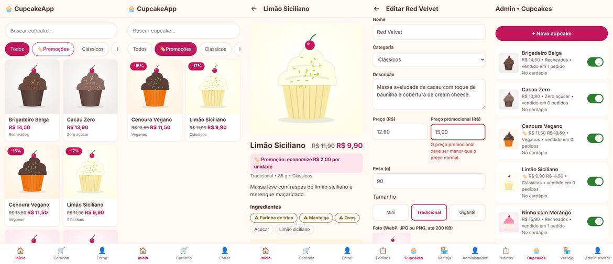

# 3. Correções e melhorias após a avaliação

Registro de **cada apontamento** dos 5 avaliadores e do que foi feito com ele. O enunciado pede para não esconder as falhas, porque elas fazem parte do aprendizado.

**Como classificar:**
- **Bug:** algo que deveria funcionar e não funcionou.
- **Melhoria:** sugestão para algo que já funciona.
- **Dúvida de uso:** o avaliador não encontrou como fazer algo. Isso também é um sinal de problema na interface.

| ID | Avaliador | Tipo | Apontamento | Decisão | O que foi feito | Commit |
|---|---|---|---|---|---|---|
| C01 | 1 – Gabriel | Melhoria | "Adicionar botões laterais para cupons ou promoções no app." | ✅ **Implementado** (promoções). Cupons de desconto continuam fora do escopo (Etapa 1, seção 1.3) | Filtro **🏷️ Promoções** no catálogo, selo de desconto (-17%) e preço riscado nos cards e nos detalhes; campo **preço promocional** no admin (MSG24 se não for menor que o preço normal); carrinho e pedido usam o preço promocional, congelado no pedido (RN05). Novos requisitos: US12 e RN12. **Migração 001** para o banco já publicado, sem apagar dados. **+23 testes** (227 no total) | ver histórico do Git |
| C02 | 5 – Gustavo | Melhoria | "Opção de recuperação de senha." | 🕒 **Adiado** | Recuperar a senha com segurança exige enviar um e-mail com link temporário, e o envio de e-mails está **fora do escopo** definido na Etapa 1 (doc. 01, seção 1.3). Fica registrado como melhoria futura: integração com um serviço de e-mail e um token de redefinição com validade | – |

**Decisões possíveis:**
- ✅ **Corrigido**;
- 🕒 **Adiado:** registrado como melhoria futura, com o motivo;
- ❌ **Não será feito:** com justificativa, por exemplo "fora do escopo definido na Etapa 1".

## Resumo

- Avaliações recebidas: **5 de 5** (Gabriel Ferreria de Oliveira, Felipe Silva, Eloisa Ferreira, José Almeida, Gustavo Ribeiro de Oliveira)
- Erros relatados pelos avaliadores: **0**
- Defeito encontrado pelo desenvolvedor ao conferir o banco depois das avaliações: **D11** (horário 3 h adiantado no site publicado), corrigido
- Sugestões: **2**: C01 (promoções), **implementada**; C02 (recuperação de senha), **adiada**
- Testes automatizados depois das correções: **230 passando**

## Evidência – C01 (promoções)

*Da esquerda para a direita: catálogo com selos de desconto, filtro "Promoções", detalhes com preço riscado e economia, admin recusando um preço promocional maior que o normal (MSG24) e lista do admin com os dois preços.*

**Como foi verificado:** 23 testes novos (`tests/test_promocoes.py`), cobrindo validação, preço de venda, filtro, carrinho, preço congelado no pedido, telas do admin e a migração aplicada num banco "antigo". Em seguida, 4 falhas foram introduzidas de propósito (ignorar o preço promocional, aceitar promoção maior, filtro que não filtra, migração rodando toda vez) e **todas foram detectadas**.

**Verificado em produção (Render, 09/11/2026):** o log do servidor registrou às 21:51 *"O banco já tem dados: nada foi apagado. Migrações aplicadas: 001_promocoes.sql."*. Em seguida, o filtro Promoções do site publicado mostrou Cenoura Vegano (-15%) e Limão Siciliano (-17%), e os pedidos existentes foram mantidos.
